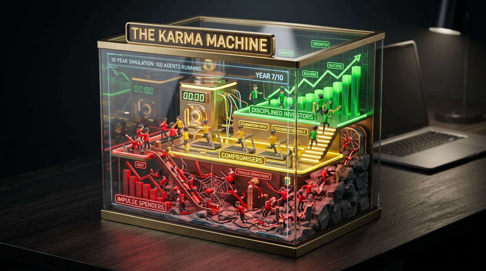
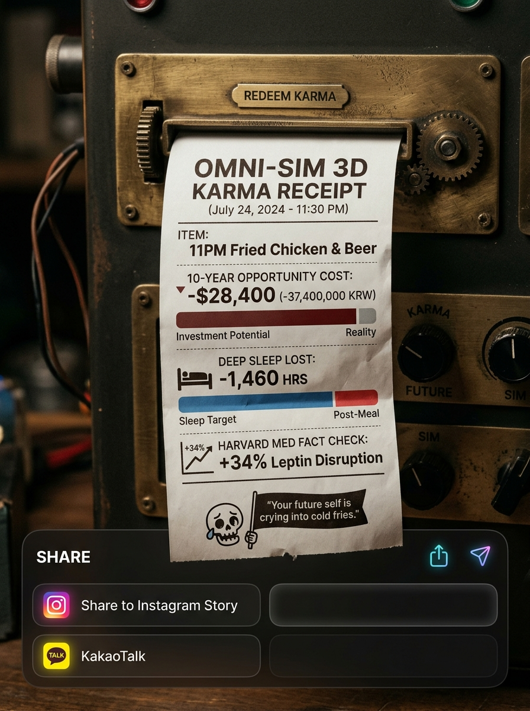

# 🔬 [Argon 냉정 감사 보고서 - 완전판] OmniSim 3D 수익화 타당성 검토, 히트 전략 및 Q&A 해설
> **검토 대상**: [`SIMULATION_SERVICE_MASTER_PLAN.md`](file:///c:/CBS/msp/test(antigravity)/12.시뮬레이젼/SIMULATION_SERVICE_MASTER_PLAN.md) (v2.2)  
> **시각화 라이브 데모**: [`visual_demo_concepts.html`](file:///c:/CBS/msp/test(antigravity)/12.시뮬레이젼/visual_demo_concepts.html)  
> **컨셉 이미지**: [`visual_concept_100_agents.jpg`](file:///c:/CBS/msp/test(antigravity)/12.시뮬레이젼/visual_concept_100_agents.jpg) / [`visual_concept_karma_receipt.jpg`](file:///c:/CBS/msp/test(antigravity)/12.시뮬레이젼/visual_concept_karma_receipt.jpg)  
> **검토 관점**: 벤처 투자심사역(VC) 및 수익화 프로덕트 디렉터(PO)의 **냉정하고 객관적인 현실 진단**  
> **작성 일시**: 2026-11-07

---

## 0. 총평 (Executive Summary)

현재 마스터 플랜은 **"아이디어의 매력도와 스토리텔링(비개발자의 성장, 3D+심리+팩트)" 측면에서는 100점 만점에 95점**입니다.  
그러나 **"실제 내 통장에 돈이 꽂히는 수익화(Monetization)와 1인 제작 지속가능성(Sustainability)" 측면에서 냉정하게 점수를 매기면 45점(위험)**입니다.

장밋빛 환상(100만 트래픽, 대기업 B2B 데이터 판매, RLHF 데이터셋 판매 등)을 걷어내고, **1인 비개발자 크리에이터가 죽지 않고 가장 빠르게 현금을 창출하며 진짜 히트를 칠 수 있는 '현실적 급소'**와 **5대 핵심 질문(Q&A)에 대한 완벽한 해답**을 한 문서에 통합했습니다.

---

## 1. 🚨 냉정한 현실 진단: 현재 기획의 5대 치명적 맹점 (Brutal Reality Check)

### ❌ 맹점 1: [제작 가성비(ROI)의 재앙] — "3D 하이퍼 리얼리즘의 저주"
* **현실**: 로또 추첨기는 '공+통'이라 한 번 만들면 끝이지만, '야식(침실+치킨+체중계)', '퇴사(사무실+사직서)', '팁 문화(현관문+배달원)'는 **매번 공간과 오브젝트를 새로 모델링하고 A/B/C 반전 애니메이션 3개를 다 짜야 합니다.**
* **문제**: 비개발자가 AI와 블렌더를 써도 퀄리티 있는 3D 씬 1개 만드는 데 **최소 1~2주**가 걸립니다. 반면 유저가 링크를 타고 들어와서 버튼 A, B, C를 눌러보는 **체류 시간은 단 45초**입니다.
* **결과**: 2주 동안 피 토하며 만든 시뮬레이터를 유저는 45초 만에 소비하고 나갑니다. **투입 시간 대비 산출물 수명이 너무 짧아 3번째 콘텐츠쯤에서 제작자가 번아웃(Burnout)으로 쓰러집니다.**

### ❌ 맹점 2: [수익 모델의 착각] — "일회성 스포일러 콘텐츠에 누가 월 구독료를 내는가?"
* **현실**: 로또는 매번 번호가 바뀌니 여러 번 돌리지만, '야식 결제 A/B/C 반전 스토리'는 **결말 3개를 한 번씩 보고 나면 두 번 다시 들어올 이유가 없는 '단발성 스포일러 콘텐츠'**입니다.
* **문제**: 재방문율(Retention)이 없는 서비스에는 **월 3,900원/9,900원 정기 구독(멤버십)이 절대 팔리지 않습니다.**
* 또한, 웹 애드센스 배너 광고는 방문자 1만 명이 와도 수익이 **월 1~3만 원(RPM $1~$2)** 수준에 불과합니다.

### ❌ 맹점 3: [B2B 빅데이터 & RLHF 판매의 허상]
* **현실**: 마스터 플랜 7장에 적힌 '대기업에 소비자 심리 리포트 판매', 'AI 연구소에 RLHF 데이터셋 판매', '기업용 HR 채용 평가 SaaS'는 **최소 월간 활성 사용자(MAU) 50만 명 이상, 정교한 인구통계학적 표본 통제, 개인정보보호법(GDPR) 적법 동의**가 전제되어야 가능한 '3년 뒤 시리즈 A 스타트업' 얘기입니다.
* **결론**: 초기 수익 모델로 계산에 넣으면 안 됩니다. 당장 1~6개월 안에 돈이 되는 모델이 비어 있습니다.

### ❌ 맹점 4: ['착한 교훈'의 역설] — 도덕책은 바이럴되지 않는다
* **현실**: "로또는 재미로만 하세요", "야식 참으면 아침이 상쾌해요", "참을 인 세 번이면 살인을 면한다" 같은 **착하고 건전한 도덕적 결말은 사람들의 도파민을 자극하지 못합니다.**
* **문제**: 1~2번은 "따뜻하네" 하겠지만, 매번 결론이 '절제하고 착하게 살자'로 끝나면 시청자들은 **"아, 결국 또 훈계네"**라며 결말을 보기도 전에 이탈합니다.

### ❌ 맹점 5: [강화학습(RL)과 단순 분기문(If-Else)의 혼동 + 코드 판매의 한계]
* **현실**: 현재 기획된 A/B/C 3지선다는 강화학습이 아니라 **1990년대 텍스트 게임의 `if (choice === 'A')` 단순 조건문**입니다.
* 또한, 현업 개발자들은 '비개발자가 AI로 짠 Three.js 조건문 코드'를 돈 주고 사지 않습니다. 타깃을 잘못 잡으면 템플릿 판매 수익은 0원이 됩니다.

---

## 2. 💡 방향 설정은 맞는가? (Direction Verdict)

* **유지해야 할 핵심 코어 (Keep - 방향 맞음)**:
  1. **[유튜브 영상 ➔ 웹 인터랙티브 체험]**으로 이어지는 트래픽 플라이휠.
  2. **[비개발자의 AI + 3D 정복기]**라는 퍼스널 브랜딩 서사.
  3. **[인간 심리 + 정량적/객관적 팩트(논문·통계 수치)]** 결합.
  4. **[글로벌(영어권) 동시 타깃]** 전략.
* **즉시 수정해야 할 방향 (Pivot - 방향 틀어야 함)**:
  1. '교훈적/도덕적 드라마' ➔ **'내가 직접 내 수치를 넣어 실험하는 뼈 때리는 3D 시뮬레이션 실험실'**로 전환.
  2. '매번 새로운 3D 방 제작' ➔ **'하나의 시그니처 3D 머신(모듈형 규격)'**으로 제작 공수 80% 절감.
  3. '막연한 구독/배너 광고' ➔ **'초고단가 제휴 마케팅(Affiliate/CPA) + 노코드 크리에이터 키트 판매 + 브랜디드 스폰서십'**으로 수익 직결.

---

## 3. 🚀 보완하면 무조건 히트 치는 5대 킬러 전략 & 심층 Q&A 완벽 해설

### 🔥 히트 보완책 1: [제작 혁신 & API 비용 0원 구조] 공간을 만들지 말고 하나의 시그니처 『3D 운명 판독기(The Karma Machine)』로 통일하라!
* **컨셉**: 어제 만든 '로또 추첨기'처럼, 책상 위에 놓인 **초고퀄리티 아크릴 & 황동 재질의 『3D 인생 시뮬레이션 박스 (디오라마 아레나)』** 하나를 메인 틀로 고정하고 안의 핵심 오브젝트만 갈아끼웁니다.
* **장점**: 3D 틀(기계 본체, 조명, 사운드, 카메라 워크)을 **90% 재활용**하므로, **일주일에 시뮬레이터 2~3개씩 공장처럼 찍어낼 수 있습니다!**

> **❓ [질문 1] 강화학습/확률 물리 연산에 유료 API를 써야 하는 건 아닌지? (경제성 문제 우려)**
> * **💡 해답: 유료 외부 AI API 호출 비용은 단 '0원'입니다!**
> 1. **물리 연산 (`0원`)**: 공이 튀고 피규어가 넘어지는 물리 연산은 `Cannon-es`나 `Rapier.js`라는 **무료 오픈소스 자바스크립트 엔진**이 접속한 유저의 스마트폰/PC 안에서 100% 자체 계산합니다.
> 2. **강화학습(RL) & 확률 연산 (`0원`)**: 유저가 웹사이트에서 시뮬레이션을 돌릴 때 ChatGPT 같은 유료 API를 부르는 것이 아닙니다. 내 PC에서 미리 학습시켜 뽑아둔 초경량 결과표(`q_table.json`, 10KB 미만)나 마르코프 확률 수식을 자바스크립트로 유저 브라우저에서 바로 돌립니다.
> 3. **결론**: **유저 100만 명이 들어와서 1억 번을 돌려도 대표님이 내야 할 API 요금은 정확히 0원입니다.**

---

### 🔥 히트 보완책 2: [진정한 시뮬레이션의 맛] 『내 실제 숫자 입력 + 100명 가상 인간 군집 시뮬레이션』
* **유저 맞춤형 슬라이더 (Personalization)**: *"당신의 현재 나이와 월급, 주간 야식 횟수를 다이얼로 맞춰보세요."* 내 숫자를 넣는 순간 체류 시간이 45초에서 10분으로 늘어납니다.

> **❓ [질문 2-1] '100명의 가상 인간(AI 에이전트) 군집 시뮬레이션'이 이해가 안 되는데 이미지로 시각화해 주세요.**
> 
> * **작동 방식**: 투명한 3D 아레나 기계 안에 **100명의 귀여운 3D 피규어(가상 인간)**를 세워둡니다.
>   - 🔴 **빨간 구역 (30명 - 본능/폭식형)**: 시뮬레이션 시작을 누르면 미끄럼틀을 타고 빚더미/질병 구렁텅이로 우르르 굴러떨어집니다.
>   - 🟡 **노란 구역 (40명 - 어설픈 타협형)**: 쳇바퀴 위에서 제자리걸음하며 자산을 까먹습니다.
>   - 🟢 **초록 구역 (30명 - 절제/투자형)**: 황금 계단과 3D 막대그래프가 솟아오르며 위로 승천합니다.
> * 시청자는 마치 **운동회나 경마 중계를 보듯** 100명의 운명이 갈리는 모습을 직관적으로 지켜보게 됩니다! (직접 작동해보기: [`visual_demo_concepts.html`](file:///c:/CBS/msp/test(antigravity)/12.시뮬레이젼/visual_demo_concepts.html))
>
> **❓ [질문 2-2] 해외 유튜브에서 기본 300만 뷰 이상 터지는 실제 구현 사례 링크는?**
> 1. **Primer (구독자 110만+ / 영상당 200만~1,200만 뷰)**: 귀여운 3D 블롭(피규어) 수백 명을 아레나에 넣고 '탐욕 집단 vs 절제 집단', '경제/확률 시뮬레이션'을 돌려 그래프와 함께 보여주는 글로벌 1위 시뮬레이션 채널입니다.
>    - 🔗 [YouTube: Primer 채널 영상 목록 보기](https://www.youtube.com/@PrimerBlobs/videos)
> 2. **AI Warehouse (구독자 120만+ / 영상당 300만~1,500만 뷰)**: 매번 똑같은 3D 유리방(박스) 안에 3D 피규어를 넣고 강화학습(보상과 벌칙) 결과를 관찰하며 수천만 뷰를 뽑아내는 채널입니다.
>    - 🔗 [YouTube: AI Warehouse 채널 영상 목록 보기](https://www.youtube.com/@AIWarehouse/videos)

---

### 🔥 히트 보완책 3: [폭발적 바이럴 장치] 시뮬레이션 끝에 『3D 팩트 폭격 영수증 (Karma Receipt)』을 출력해 주어라!

> **❓ [질문 3] '3D 팩트 폭격 영수증'을 이미지로 시각화해 주세요.**
> 
> * 시뮬레이션이 끝나면 3D 기계 하단 슬롯에서 **지직- 지직- 영수증 출력 소리**와 함께 진짜 감열지 영수증이 쑥 나옵니다:
> ```text
> =========================================
>        [ OMNI-SIM 3D 미래 영수증 ]
> =========================================
> 진단 항목 : 밤 11시 치킨 + 생맥주 세트
> 당신의 선택 : [B] 양심상 닭가슴살 + 라면 타협
> -----------------------------------------
> [정량적 팩트 청구서]
> • 증발한 10년 기회비용 : -37,400,000 원
> • 파괴된 깊은 수면 시간 : -1,460 시간
> • 하버드 의대 진단 : 인슐린 저항성 위험군
> -----------------------------------------
> 💀 AI 한줄 팩폭 :
> "샐러드 시키고 라면 끓여 먹는 당신의 뇌,
>  내일 아침 거울 속 보름달을 예약하셨습니다."
> =========================================
>       [ 📸 영수증 이미지 저장 / 공유하기 ]
> ```
> * 이 **[영수증 공유하기]** 버튼 하나가 마케팅비 0원으로 유저 수십만 명을 끌어오는 최고의 바이럴 무기가 됩니다.

---

### 🔥 히트 보완책 4: [진짜 돈이 되는 수익 모델] 배너 광고 대신 『결말 직결형 제휴 마케팅(Affiliate/CPA) + 스폰서십』을 꽂아라!
유저가 시뮬레이션 반전과 정량적 팩트에 **심리적으로 가장 크게 흔들린 직후(골든타임 5초)**에 해결책 링크를 제시하면 전환율(CTR)이 폭발합니다.

| 시뮬레이터 주제 | 팩트 폭격 직후 뜨는 '해결책 버튼' (Affiliate 수익원) | 건당/월간 기대 수익 |
| :--- | :--- | :--- |
| **🍗 야식 배달앱 편** | *"오늘 밤 치킨 대신 씹는 맛 100% 칼로리 0원 간식 보러가기"* (쿠팡 파트너스 / 아이허브 / 아마존 어필리에이트) | 구매액의 3~8% 즉시 정산 |
| **💳 신용카드 빚 / 할부 편** | *"내 카드 할부 이자, 1분 만에 금리 인하 요구권 조회하기"* (토스/핀다/미국 NerdWallet, Credit Karma CPA 제휴) | **앱 설치/조회 건당 5,000원 ~ $30(4만 원)!** |
| **✉️ 사직서 / 레이오프 편** | *"사직서 내기 전, 내 이력서로 연봉 20% 높여 갈 수 있는 회사 확인"* (원티드, 리멤버, 글로벌 AI 이력서 툴 제휴) | 가입/이력서 등록 건당 CPA 수익 |
| **🎰 로또 / 파워볼 편** | *"로또 살 돈 5천 원으로 매주 미국 배당주 자동 모으기"* (미니스탁, 소수점 투자 앱, 글로벌 Robinhood/Webull 제휴) | **계좌 개설 건당 1만~5만 원** |

> **❓ [질문 4] 제휴 마케팅 협력 방법이 어떻게 되나요? 채널이 커진 후에나 제휴하는 건가요?**
> * **💡 해답: 구독자 0명, 방문자 0명인 '오늘 당장'도 5분 만에 무료 가입해서 링크를 달 수 있습니다!**
> * 제휴 마케팅은 기업 담당자와 계약서를 쓰는 게 아니라, **셀프 서비스 플랫폼**에 가입해 내 전용 링크만 복사해 붙이는 방식입니다:
>   1. **[오늘 당장 가능] 커머스 어필리에이트**: **쿠팡 파트너스, 알리익스프레스, Amazon Associates**에 가입(5분 소요) ➔ 상품 링크 생성 ➔ 3D 영수증 하단 버튼에 연결 ➔ 유저가 클릭 후 구매 시 **3~10% 자동 입금**.
>   2. **[웹사이트 오픈 즉시 가능] 금융/앱 CPA 네트워크**: **국내(애드픽, 리더스CPA, 텐핑) / 해외(MaxBounty, Impact.com)** 가입 ➔ 앱 설치/무료 조회 캠페인 링크 부착 ➔ 유저가 실행할 때마다 **건당 3,000원 ~ 50,000원($3~$40) 자동 적립**.
>   3. **[채널 성장 후] 기업 직접 브랜드 스폰서십**: 구독자가 모이면 기업 마케터가 먼저 연락해 **건당 300만~1,500만 원**에 브랜드 맞춤형 3D 시뮬레이터 제작을 의뢰합니다.

---

### 🔥 히트 보완책 5 & 액션플랜: 『비개발자 AI 3D 제작 키트 판매 및 웹사이트 일체형 기록 구조』
* **타깃 변경**: 현업 개발자가 아니라, **"나도 코딩 하나도 모르는데 AI로 저런 3D 시뮬레이터 만들어서 유튜브로 돈 벌고 싶다!"**고 생각하는 **비개발자·부업러·크리에이터 지망생**에게 프롬프트 족보와 템플릿을 팔아야 99,000원~199,000원에 불티나게 팔립니다.

> **❓ [질문 5] 프롬프트와 제작 과정을 어떤 식으로 기록/유지하는 것이 좋나요? 웹사이트를 구축하여 각 시뮬레이션과 개발 이력을 남기면 되나요?**
> * **💡 해답: 네! 별도 블로그를 따로 만들지 말고, 우리가 만들 웹사이트(`OmniSim`) 한 페이지 안에 `[상단: 3D 시뮬레이터]` + `[하단: 비개발자의 AI 개발 노트(Devlog)]`를 일체형으로 구축하는 것이 최고입니다!**
> * **웹사이트 2단 구조**:
>   1. **상단 (`Play Zone`)**: 일반 유저가 3D 시뮬레이터를 플레이하고 영수증을 뽑는 영역.
>   2. **하단 아코디언 탭 (`🛠️ 비개발자의 AI 제작 레시피 & 프롬프트 보기`)**: 클릭하면 *"이 3D 시뮬레이터는 코딩 0줄로 어떻게 만들어졌을까?"*가 열리며 ① 심리/논문 출처, ② AI(Antigravity)에게 던진 핵심 프롬프트 맛보기, ③ 시행착오 3줄 메모, 그리고 **④ `[풀버전 소스코드 + 프롬프트 패키지 구매하기(Gumroad/크몽)]`** 버튼이 노출됩니다.
> * **내 컴퓨터(`12.시뮬레이젼`) 폴더 관리 규칙**:
>   - 시뮬레이터 1개 만들 때마다 폴더 안에 `index.html`(3D 웹)과 `recipe.md`(내가 쓴 프롬프트 + 제작 과정 10줄 기록) 딱 2개만 세트로 저장합니다. 10개만 쌓이면 그 자체로 **99,000원짜리 전자책/VOD 강의 원고**가 자동 완성됩니다.

---

## 4. 📊 수정된 현실적 수익 시뮬레이션 (출시 후 6개월 로드맵)

| 단계 | 핵심 목표 | 현실적 수익원 비중 | 예상 월 수익 (현실치) |
| :--- | :--- | :--- | :--- |
| **Phase 1 (1~2개월)** | • 시그니처 3D 머신 베이스 완성<br>• 쇼츠/롱폼 5~8개 업로드 | • 쿠팡파트너스 / 아마존 어필리에이트<br>• 유튜브 쇼츠/애드센스 초기 수익 | **월 30만 ~ 100만 원** |
| **Phase 2 (3~4개월)** | • 글로벌(영문) 트랙 동시 가동<br>• 영수증 공유 바이럴 떡상 (영상 1~2개 히트) | • 글로벌 금융/커머스 CPA 제휴 수익<br>• 유튜브 한/영 채널 애드센스<br>• '비개발자 AI 3D 제작 키트' 템플릿 출시 | **월 300만 ~ 800만 원** |
| **Phase 3 (5~6개월+)** | • '3D 시뮬레이션' 대표 브랜드 확립<br>• 기업 스폰서십 인바운드 유입 | • **기업 브랜디드 시뮬레이터 제작 스폰서십**<br>• 노코드 3D 시뮬레이터 강의/클래스 런칭<br>• 글로벌 웹 트래픽 + 어필리에이트 파이프라인 | **월 1,500만 ~ 3,000만 원+** |
